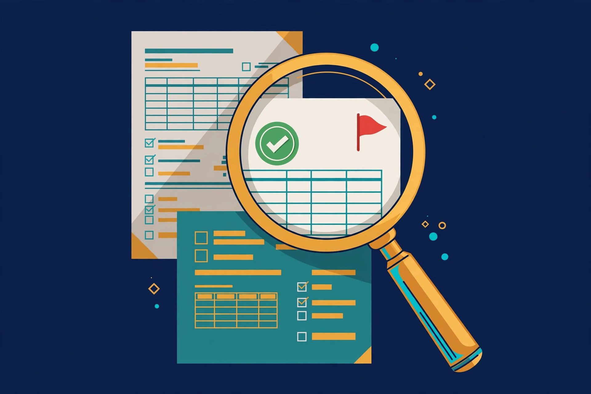

# QuoteGuard — Quote Analysis & Verification

The quote looked fine. Then the price grew after you signed.

QuoteGuard is a fixed audit discipline for vendor quotes: 7 documented traps, checked the same way every time, running on your own AI assistant. No subscription, no software to install — a prompt pack you use with the AI you already have.

## The 7 traps it audits

1. **Vague line items** — unspecified work gets defined later, in the vendor's favor
2. **Hidden costs** — the gap between the quote and the invoice
3. **Missing deliverables** — what's not specified becomes a paid extra
4. **Payment risks** — killer upfronts and term mismatches
5. **Scope-creep openings** — uncapped "additional work" clauses
6. **Pricing inconsistencies** — line items that don't add up
7. **Competing quotes** — normalizing multiple quotes so you can actually compare them

## What's inside

- QuoteGuard v1.0 prompt pack (works with your AI assistant)
- Vendor Quote Trap Library — the 7 traps, documented with real-world patterns
- Fixed audit workflow: same checks, same order, every quote

Free: the 7-trap checklist article — https://dev.to/khaledmurad/7-vendor-quote-traps-that-cost-real-people-thousands-free-checklist-1110

## Who it's for / not for

**For:** freelancers, agencies, and small businesses who sign vendor/subcontractor quotes and want a second pair of eyes before committing.
**Not for:** regulated procurement (government/defense), or anyone who wants legal advice — this is a commercial decision aid, not a lawyer.

## Get it

Commercial product — $19 one-time, instant download, 30-day guarantee:

- 🛒 [Buy on SellApp — $19 (USDT)](https://digitaltoolkitstore.sell.app/product/quoteguard-quote-analysis-verification)
- 🛒 [Buy on Getly — $19](https://www.getly.store/product/quoteguard-quote-analysis-verification)
- 🏬 [Digital Toolkit Store](https://www.getly.store)

## Contact

- Telegram: https://t.me/Digitaltoolkitstore
- Email: poodepoo@gmail.com
